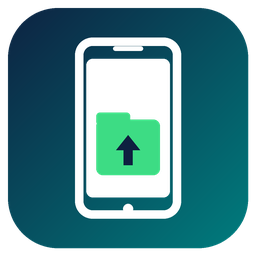

<p align="center">
  
</p>

<h1 align="center">AndroidFS-F</h1>

<p align="center">
  Підключайте Android-телефон як звичайний диск Windows через ADB. Без MTP і без додаткових програм на телефоні.
</p>

<p align="center">
  <a href="README.md">English</a> · Українська
</p>

---

## Огляд

AndroidFS-F — форк [AndroidFS](https://github.com/Lauriethefish/AndroidFS). На телефоні запускається невеликий демон, а сховище телефону передається у Windows через драйвер файлової системи [Dokan](https://dokan-dev.github.io/). Телефон з'являється у Провіднику з власною літерою диска і працює з будь-якою програмою.

Версія 0.3 додає програму з вікном, списком пристроїв і керуванням, підтримку 32-бітних ARM-телефонів та низку виправлень стабільності.

## Можливості

- **Програма з вікном.** Список підключених пристроїв, їхній стан і кнопки **Mount**, **Unmount**, **Open**.
- **Автоматичне монтування.** Підключили телефон — з'явився диск; відключили — диск прибирається коректно.
- **Підтримка `arm64-v8a` і `armeabi-v7a`.** Потрібний демон обирається за процесором телефону.
- **Повний доступ на читання й запис.** Створення, копіювання, перейменування, переміщення і видалення файлів та папок. Помилка запису (наприклад, повний диск) повертається у Windows, а диск не відпадає.
- **Журнал** у вікні та у файлі.
- **Автозапуск з Windows** у згорнутому вигляді.
- **Один інсталятор**, який ставить і Dokan.

## Вимоги

| Компонент | Вимога |
|-----------|--------|
| Windows | 7 SP1 або новіша, 64-бітна (для Dokan на Windows 7 потрібне оновлення підписів SHA-2) |
| Драйвер | [Dokan 1.5.x](https://github.com/dokan-dev/dokany/releases/tag/v1.5.1.1000) (ставить інсталятор) |
| ADB | `adb.exe` з [platform-tools](https://developer.android.com/tools/releases/platform-tools) у `PATH` або вказаний у налаштуваннях |
| Телефон | Android з увімкненим **налагодженням USB**, `arm64-v8a` або `armeabi-v7a` |
| Графіка | Відеодрайвер з OpenGL 2.0 (потрібен для вікна) |

## Встановлення

1. Завантажте `androidfs_f_installer.exe` з останнього успішного запуску на сторінці [Actions](https://github.com/AmakerGame/AndroidFS-F/actions) (артефакт **installer**).
2. Запустіть інсталятор, за бажанням увімкніть автозапуск. Якщо просить, перезавантажте Windows, щоб завантажився драйвер Dokan.
3. Переконайтеся, що `adb.exe` доступний.

Переносна версія `androidfs_driver.exe` лежить в артефакті **standalone**, але Dokan потрібен і для неї.

## Використання

1. На телефоні: *Налаштування > Про телефон*, сім разів торкніться *Номер збірки*, потім у *Параметрах розробника* увімкніть *Налагодження USB*.
2. Підключіть телефон кабелем і дозвольте комп'ютер на екрані телефону.
3. Запустіть **AndroidFS-F**. Телефон з'явиться на вкладці **Devices** і змонтується на першу вільну літеру, починаючи з `Q:`.
4. **Open** відкриває диск у Провіднику, **Unmount** безпечно відмонтовує його перед відключенням.

Закриття вікна відмонтовує всі диски і завершує програму.

## Налаштування

Вкладка **Settings**, файл `%APPDATA%\AndroidFS-F\settings.ini`.

| Параметр | Опис | За замовчуванням |
|----------|------|------------------|
| Mount automatically | Монтувати пристрої одразу після виявлення | Увімкнено |
| Start with Windows | Запуск згорнутим при вході | Вимкнено |
| ADB path | Повний шлях до `adb.exe` | Автопошук |
| Drive root | Каталог Android, який показується як диск | `/storage/emulated/0` |

Для автопошуку `adb.exe` перевіряються `ANDROIDFS_ADB`, `ANDROID_HOME`, `ANDROID_SDK_ROOT`, `%LOCALAPPDATA%\Android\Sdk\platform-tools` і `PATH`.

Параметр командного рядка `--background` запускає програму згорнутою.

## Збірка

Потрібні: nightly Rust з `rust-src` (програма збирається під `x86_64-win7-windows-msvc`, тому працює і на Windows 7), [cargo-ndk](https://github.com/bbqsrc/cargo-ndk), Android NDK (змінна `ANDROID_NDK_HOME`), Dokan 1.5.x із файлами для розробки та Windows SDK.

```powershell
rustup toolchain install nightly --component rust-src
rustup +nightly target add aarch64-linux-android armv7-linux-androideabi
cargo install cargo-ndk
./build.ps1
```

Спочатку збираються демони для двох архітектур, потім програма Windows, яка вбудовує їх через `include_bytes!`. Результат: `target/x86_64-win7-windows-msvc/release/androidfs_driver.exe`. Логіку демона і протокол можна перевірити без телефону командою `cargo test --lib`.

## Усунення проблем

| Симптом | Рішення |
|---------|---------|
| «ADB is not available» | Встановіть platform-tools і додайте `adb.exe` у `PATH` або вкажіть шлях у Settings |
| Телефон не у списку | Увімкніть налагодження USB, перепідключіть кабель, підтвердьте ключ на телефоні |
| Статус *Failed* з повідомленням Dokan | Встановіть Dokan 1.5.x і перезавантажте Windows |
| Вікно не відкривається | Оновіть відеодрайвер: потрібен OpenGL 2.0 |
| «Already running» | Програма вже запущена, знайдіть її на панелі завдань |

Докладніше: вкладка **Log** або `%APPDATA%\AndroidFS-F\androidfs.log`.

## Обмеження

- Швидкість обмежена налагодженням USB, а права доступу — це права користувача `shell`.
- Підтримуються лише `arm64-v8a` і `armeabi-v7a`.
- Дескриптори безпеки файлів та альтернативні потоки не підтримуються.

## Ліцензія

GNU GPL v3, див. [LICENSE](LICENSE). Форк AndroidFS від Lauriethefish; оригінальний readme — у [READMEoriginal.md](READMEoriginal.md).
